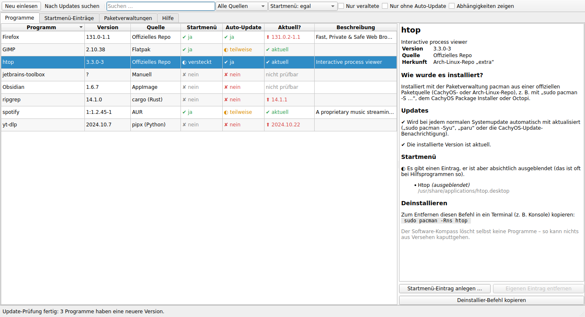
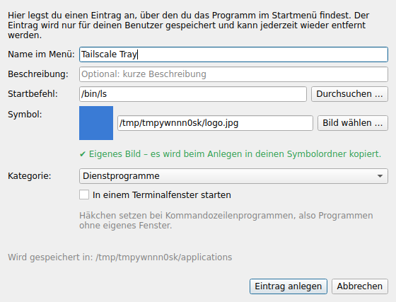
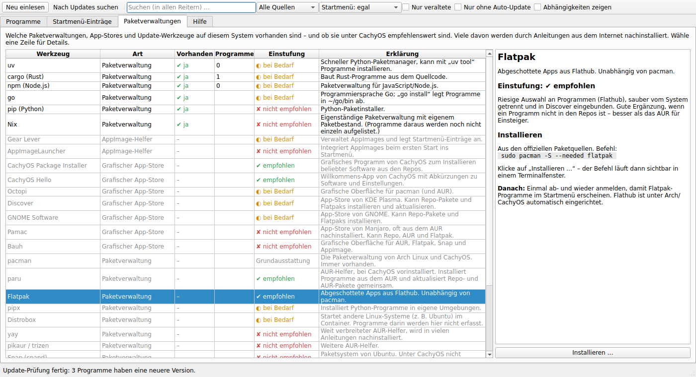
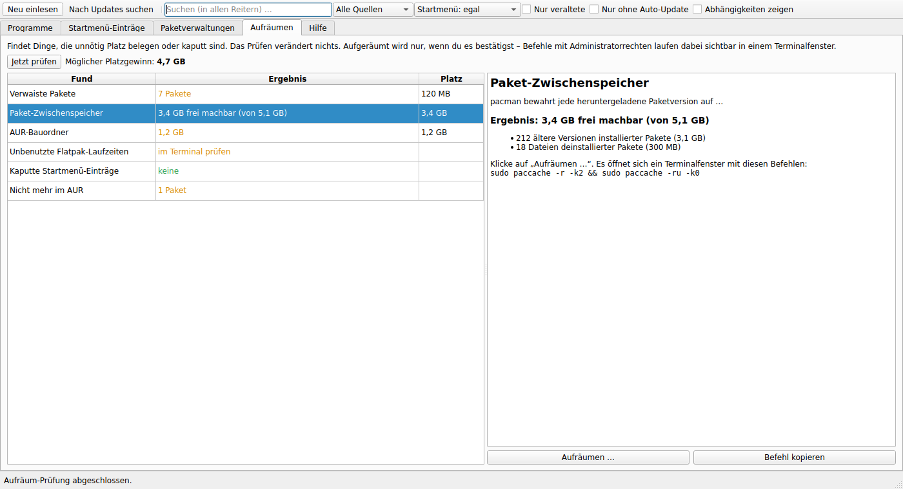

# 🧭 Cachy Software-Kompass

**Welche Programme habe ich eigentlich installiert – und woher kommen die?**

Der Cachy Software-Kompass ist ein Programm mit grafischer Oberfläche für
[CachyOS](https://cachyos.org/). Es beantwortet auf einen Blick:

- 📦 **Was ist installiert?** Es findet alle Programme, egal auf welchem Weg sie installiert wurden.
- 🔎 **Wie wurde es installiert?** Ob offizielles Repo, AUR, Flatpak, Snap, AppImage, pipx, cargo, npm, Homebrew oder von Hand kopiert.
- 🗂️ **Ist es im Startmenü?** Falls nicht, legst du mit zwei Klicks einen Eintrag an.
- 🔄 **Wird es automatisch aktualisiert?** Also ob das normale CachyOS-Systemupdate das Programm mit erfasst.
- ⬆️ **Ist es aktuell?** Das Programm prüft auf Wunsch im Internet, ob es eine neuere Version gibt.
- 🧰 **Welche Paketverwaltungen gibt es?** Zum Beispiel ob yay, Flatpak oder Snap durch eine Anleitung nachinstalliert wurden.


<sub>(Screenshot mit Beispieldaten)</sub>

> **Sicher:** Der Software-Kompass schaut nur nach. Er installiert, aktualisiert
> und löscht **keine** Programme. Das Einzige, was er anlegen kann, sind
> Startmenü-Einträge in deinem eigenen Benutzerordner, und nur genau diese kann
> er auch wieder entfernen.

---

## Inhalt

1. [Installation](#installation)
2. [Starten](#starten)
3. [Bedienung](#bedienung)
4. [Begriffe einfach erklärt](#begriffe-einfach-erklärt)
5. [Welche Quellen werden erkannt?](#welche-quellen-werden-erkannt)
6. [Was ändert das Programm an meinem System?](#was-ändert-das-programm-an-meinem-system)
7. [Textmodus für das Terminal](#textmodus-für-das-terminal)
8. [Deinstallation](#deinstallation)
9. [Häufige Fragen & Probleme](#häufige-fragen--probleme)
10. [Bekannte Grenzen](#bekannte-grenzen)
11. [Für Entwickler](#für-entwickler)

---

## Installation

Du brauchst nur ein Terminal. Unter CachyOS mit KDE heißt es **Konsole**, du
findest es im Startmenü. Kopiere die folgenden Zeilen nacheinander hinein und
drücke jeweils Enter:

```bash
# 1. Das Programm herunterladen
git clone https://github.com/zeromaster3307/A-Cachy-OS-Tool-for-dummies.git
cd A-Cachy-OS-Tool-for-dummies

# 2. Installieren
./install.sh
```

Das Installationsskript

1. installiert, falls sie fehlen, die zwei benötigten Pakete aus den offiziellen
   Repos und fragt dafür nach deinem Passwort:
   - `pyside6` für die grafische Oberfläche
   - `pacman-contrib` für die genaue Update-Prüfung
2. kopiert das Programm nach `~/.local/share/cachy-kompass`
3. legt einen Startmenü-Eintrag **„Cachy Software-Kompass“** an.

> 💡 Ohne `git` geht es auch: Lade auf der GitHub-Seite über den grünen Knopf
> **„Code“ → „Download ZIP“** das Archiv herunter, entpacke es, öffne den Ordner
> im Dateimanager und wähle *Rechtsklick → Terminal hier öffnen*. Dort dann
> `./install.sh` eingeben.

### Auf eine neue Version aktualisieren

Im heruntergeladenen Ordner:

```bash
cd A-Cachy-OS-Tool-for-dummies
git pull          # neuesten Stand herunterladen
./install.sh      # installierte Version ersetzen
```

Wichtig: `git clone` bzw. `git pull` laden nur den Code herunter. Erst
`./install.sh` ersetzt das Programm, das im Startmenü startet. Danach den
Software-Kompass einmal schließen und neu öffnen.

Die alte Version musst du **nicht** vorher löschen, sie wird automatisch
ersetzt. Selbst angelegte Startmenü-Einträge bleiben erhalten.

**Welche Version habe ich?** Die Versionsnummer steht im Fenstertitel und oben
im Reiter „Hilfe“, im Terminal zeigt sie `cachy-kompass --version`. Was sich
zwischen den Versionen geändert hat, steht in [CHANGELOG.md](CHANGELOG.md).

### Ohne Installation ausprobieren

```bash
sudo pacman -S --needed pyside6 pacman-contrib
python -m cachy_kompass
```

(im heruntergeladenen Ordner ausführen)

---

## Starten

- Über das **Startmenü**: „Cachy Software-Kompass“ (Kategorie *System*)
- oder im Terminal: `cachy-kompass`

Beim Start werden alle Programme eingelesen. Das dauert je nach System ein paar
Sekunden.

---

## Bedienung

### Reiter „Programme“

Die Hauptansicht. Jede Zeile ist ein Programm.

| Spalte | Bedeutung |
|---|---|
| **Programm** | Name des Programms (wenn möglich so, wie er im Startmenü steht) |
| **Version** | installierte Version |
| **Quelle** | auf welchem Weg es installiert wurde (siehe [Begriffe](#begriffe-einfach-erklärt)) |
| **Startmenü** | ✔ sichtbar · ◐ Eintrag vorhanden, aber ausgeblendet · ✘ kein Eintrag |
| **Auto-Update** | ✔ wird beim Systemupdate mit aktualisiert · ◐ nur mit dem richtigen Werkzeug · ✘ musst du selbst aktualisieren |
| **Aktuell?** | erst nach Klick auf **„Nach Updates suchen“**: ✔ aktuell · ⬆ neuere Version verfügbar |
| **Beschreibung** | Kurzbeschreibung des Pakets |

Ein Klick auf ein Programm zeigt rechts alle Details: woher es kommt, wie es
aktualisiert wird, welche Startmenü-Einträge es hat und mit welchem Befehl man
es wieder deinstalliert.

Ein Klick auf eine Spaltenüberschrift sortiert die Liste, zum Beispiel nach
„Aktuell?“, dann stehen alle veralteten Programme oben.

**Werkzeugleiste oben:**

| Element | Funktion |
|---|---|
| **Neu einlesen** (F5) | sucht alle Programme erneut |
| **Nach Updates suchen** | fragt im Internet nach neueren Versionen; dabei wird **nichts** installiert |
| **Suchen …** | filtert **alle Reiter** gleichzeitig: Namen, Beschreibungen, Namen der Startmenü-Einträge (z. B. „Claude Code“ für das Programm `claude`), Befehle und Pfade |
| **Alle Quellen** | zeigt nur Programme aus einer bestimmten Quelle, z. B. nur Flatpaks |
| **Startmenü: …** | zeigt z. B. nur Programme **ohne** Startmenü-Eintrag |
| **Nur veraltete** | zeigt nur Programme mit verfügbarem Update |
| **Nur ohne Auto-Update** | zeigt nur Programme, um deren Updates du dich selbst kümmern musst |
| **Abhängigkeiten zeigen** | blendet auch Bibliotheken und automatisch mitinstallierte Pakete ein (das sind oft über 1000) |

### Einen Startmenü-Eintrag anlegen

1. Programm in der Liste auswählen
2. **„Startmenü-Eintrag anlegen …“** klicken (oder Doppelklick auf die Zeile)
3. Die Felder sind schon sinnvoll vorausgefüllt. Prüfen und auf **„Eintrag anlegen“** klicken.



- **Startbefehl:** Was beim Klick auf den Eintrag ausgeführt wird. Normalerweise
  passt der Vorschlag.
- **Symbol:** Der Name eines Symbols aus deinem Symbol-Design oder eine eigene
  Bilddatei über **„Bild wählen …“**. Unter dem Feld steht, ob ein passendes
  Symbol gefunden wurde. Falls nicht, lade z. B. das Logo von der Webseite des
  Programms herunter und wähle es aus.
  - Am besten eignen sich **SVG** oder **PNG**. JPG, ICO, WebP usw. werden
    automatisch in PNG umgewandelt.
  - Das Bild wird nach `~/.local/share/icons/cachy-kompass/` **kopiert**. Du
    kannst die heruntergeladene Datei danach also ruhig löschen.
- **In einem Terminalfenster starten:** Für Programme ohne eigenes Fenster
  (Kommandozeilenprogramme wie `yt-dlp` oder `htop`). Ohne Häkchen würde sich
  beim Klick scheinbar nichts tun.

### Einen Startmenü-Eintrag entfernen

Über **„Eintrag entfernen …“** (oder im Reiter „Startmenü-Einträge“) lassen
sich alle Einträge löschen, die in **deinem Benutzerordner** liegen
(`~/.local/share/applications`):

- Einträge, die der Software-Kompass angelegt hat, werden mitsamt ihrem
  kopierten Symbol entfernt.
- Einträge, die du selbst oder ein anderes Programm angelegt hat (z. B. von
  Hand, mit Claude, über Steam, Gear Lever oder AppImageLauncher), lassen sich
  ebenfalls entfernen. Vorher erscheint aber ein deutlicher Warnhinweis.
- Ersetzt ein Benutzereintrag einen Systemeintrag gleichen Namens, weist der
  Software-Kompass darauf hin. Nach dem Löschen erscheint dann wieder der
  ursprüngliche Systemeintrag.
- **Systemeinträge** (`/usr/share/applications` usw.) gehören zu Paketen und
  werden **nie** gelöscht. Sie verschwinden, wenn man das Programm deinstalliert.

Das Programm selbst bleibt dabei immer installiert, nur der Menüeintrag
verschwindet.

### Reiter „Startmenü-Einträge“

Listet **alle** Startmenü-Einträge des Systems und zeigt, zu welchem Programm
sie gehören. Steht in der Spalte „Startbefehl“ **„Programm fehlt“**, zeigt der
Eintrag auf ein Programm, das es nicht mehr gibt. Der Eintrag ist dann
vermutlich ein Überbleibsel einer Deinstallation.

### Reiter „Paketverwaltungen“



Zeigt, welche Paketverwaltungen, App-Stores und Update-Werkzeuge vorhanden sind
und wie viele Programme jeweils darüber installiert wurden. So siehst du zum
Beispiel, ob du irgendwann für eine Anleitung Snap oder Homebrew nachinstalliert
hast.

Jedes Werkzeug hat eine **Einstufung** mit Begründung:

| Einstufung | Bedeutung | Beispiele |
|---|---|---|
| ✔ **empfohlen** | passt gut zu CachyOS, risikoarm | Flatpak, paru, CachyOS Package Installer, cachy-update |
| ◐ **bei Bedarf** | nützlich, wenn man es braucht, sonst überflüssig | pipx, uv, Gear Lever, Topgrade, Discover, Distrobox |
| ✘ **nicht empfohlen** | doppelt, am System vorbei oder unter Arch unüblich | Snap, Homebrew, Nix, pip, yay (neben paru), Pamac |

**Installieren:** Fehlt ein Werkzeug, das „empfohlen“ oder „bei Bedarf“ ist,
kannst du es mit **„Installieren …“** nachinstallieren. Dabei gilt:

- Es wird **nur aus den offiziellen Paketquellen** installiert (CachyOS/Arch).
  Der Software-Kompass prüft vorher mit `pacman -Si`, ob das Paket dort wirklich
  verfügbar ist. Einzige Ausnahme: Gear Lever wird von Flathub geholt, wenn es
  nicht in den Repos ist und Flatpak schon vorhanden ist.
- **Nichts aus dem AUR, keine Skripte aus dem Internet.**
- Der Befehl läuft **sichtbar in einem Terminalfenster** (z. B. Konsole). Dort
  gibst du selbst dein Passwort ein, und pacman fragt vor der Installation noch
  einmal nach. Der Software-Kompass bekommt nie Administratorrechte.
- „Nicht empfohlene“ Werkzeuge bekommen **keinen** Installieren-Knopf, nur die
  Begründung und eine bessere Alternative.
- **Entfernen** geht bewusst nicht per Knopf. Entfernt man eine
  Paketverwaltung, verschwinden auch alle Programme, die darüber installiert
  wurden. Die Detailansicht zeigt dazu die Anzahl der betroffenen Programme und
  den Befehl.

### Reiter „Aufräumen“


<sub>(Screenshot mit Beispieldaten)</sub>

Ein Klick auf **„Jetzt prüfen“** sucht nach Dingen, die unnötig Platz belegen
oder kaputt sind. Das Prüfen selbst verändert nichts.

| Fund | Was ist das? | Aufräumen |
|---|---|---|
| **Verwaiste Pakete** | Abhängigkeiten, die kein Programm mehr braucht | `sudo pacman -Rns …`, pacman zeigt vorher die Liste |
| **Paket-Zwischenspeicher** | alte Paketversionen in `/var/cache/pacman/pkg`, oft mehrere GB | `paccache` behält die 2 neuesten Versionen jedes Pakets (für den Notfall-Rückweg) |
| **AUR-Bauordner** | Reste vom Bauen aus dem AUR (paru/yay) in `~/.cache` | Ordner löschen, werden beim nächsten Update neu angelegt |
| **Unbenutzte Flatpak-Laufzeiten** | Laufzeiten, die keine App mehr braucht | `flatpak uninstall --unused`, Flatpak zeigt vorher die Liste |
| **Kaputte Startmenü-Einträge** | Einträge, deren Programm fehlt | Einträge in deinem Benutzerordner werden direkt entfernt |
| **Nicht mehr im AUR** | AUR-Pakete, die dort nicht mehr stehen und keine Updates mehr bekommen | **kein Knopf**, nur Erklärung und Befehl, denn du entscheidest selbst |

Oben steht, wie viel Platz sich insgesamt gewinnen lässt. Mit **„Aufräumen …“**
öffnet sich nach einer Rückfrage ein Terminalfenster mit den angezeigten
Befehlen. Dort siehst du alles und bestätigst selbst. Danach erneut auf
„Jetzt prüfen“ klicken.

### Reiter „Hilfe“

Eine Kurzfassung dieser Anleitung direkt im Programm.

---

## Begriffe einfach erklärt

| Begriff | Erklärung |
|---|---|
| **Paket** | Ein Programm (oder Teil davon) in einer Form, die eine Paketverwaltung installieren, aktualisieren und entfernen kann. |
| **pacman** | Die Paketverwaltung von CachyOS bzw. Arch Linux. Sie kümmert sich um die offiziellen Pakete. |
| **Repo** (Repository) | Ein Online-Lager mit fertigen Paketen. CachyOS hat eigene Repos (`cachyos`, `cachyos-v3` …, für deinen Prozessor optimiert) und nutzt zusätzlich die von Arch Linux (`core`, `extra`, `multilib`). |
| **AUR** | Das *Arch User Repository*: eine riesige Sammlung von Bauanleitungen aus der Community. Nicht offiziell geprüft. Wird mit einem **AUR-Helfer** wie `paru` (bei CachyOS dabei) oder `yay` benutzt. |
| **Chaotic-AUR** | Ein zusätzliches, inoffizielles Repo mit fertig gebauten AUR-Paketen. Wird oft nach Anleitungen eingerichtet. |
| **Flatpak / Flathub** | Ein System für abgeschottete Apps, unabhängig von der Linux-Distribution. Flathub ist der größte Flatpak-„Store“. |
| **Snap** | Ähnlich wie Flatpak, stammt von Ubuntu. Unter CachyOS unüblich. |
| **AppImage** | Ein Programm in einer einzigen Datei, die man herunterlädt und direkt startet, ohne Installation. |
| **pipx / uv** | Werkzeuge, um Python-Programme sauber getrennt vom System zu installieren. |
| **cargo** | Werkzeug der Programmiersprache Rust. Kann Programme aus dem Quellcode bauen und installieren. |
| **npm** | Paketverwaltung für JavaScript/Node.js. |
| **Homebrew** | Paketverwaltung aus der macOS-Welt, gibt es auch für Linux. |
| **Abhängigkeit** | Ein Paket, das nicht du, sondern ein anderes Programm braucht, z. B. eine Bibliothek. Wird automatisch mitinstalliert. |
| **.desktop-Datei** | Eine kleine Textdatei, die einen Startmenü-Eintrag beschreibt (Name, Symbol, Startbefehl). Systemweite liegen in `/usr/share/applications`, deine eigenen in `~/.local/share/applications`. |
| **Systemupdate** | Unter CachyOS: `sudo pacman -Syu` aktualisiert alle Repo-Pakete, `paru` zusätzlich alle AUR-Pakete. Flatpaks werden mit `flatpak update` aktualisiert. |

---

## Welche Quellen werden erkannt?

| Quelle | Wie erkannt | Auto-Update beim Systemupdate? | Wie wird „Aktuell?“ geprüft |
|---|---|---|---|
| **Offizielles Repo** (CachyOS, Arch, Zusatz-Repos wie Chaotic-AUR) | `pacman -Qi`, `pacman -Sl` | ✔ ja (`pacman -Syu`, `paru`) | `checkupdates` (lädt eine frische Paketliste in einen temporären Ordner, ohne das System zu ändern) |
| **AUR** | `pacman -Qm` (Pakete, die in keinem Repo stehen) | ◐ nur mit AUR-Helfer (`paru`, `yay`), nicht mit reinem `pacman -Syu` | Abfrage der AUR-Webschnittstelle |
| **Flatpak** | `flatpak list --app` | ◐ mit `flatpak update` oder Discover/GNOME Software | `flatpak remote-ls --updates` |
| **Snap** | `snap list` | ✔ ja, snapd aktualisiert selbstständig | `snap refresh --list` |
| **AppImage** | Suche nach `*.AppImage` in `~/Applications`, `~/AppImages`, `~/Downloads`, `~/.local/bin`, `/opt` u. a. | ✘ nein | nicht möglich (keine zentrale Versionsliste) |
| **pipx** | `pipx list --json` | ✘ nein (`pipx upgrade-all`) | Abfrage bei PyPI |
| **uv tool** | `uv tool list` | ✘ nein (`uv tool upgrade --all`) | Abfrage bei PyPI |
| **cargo** | `cargo install --list` | ✘ nein | Abfrage bei crates.io |
| **npm** | `npm ls -g` (ohne die von pacman verwalteten) | ✘ nein (`npm update -g`) | `npm outdated -g` |
| **Homebrew** | `brew list --versions` | ✘ nein (`brew upgrade`) | `brew outdated` |
| **Manuell** | Programme in `~/.local/bin`, `~/bin`, `~/go/bin`, `/usr/local/bin` und Ordner in `/opt`, die keiner Paketverwaltung gehören | ✘ nein | nicht möglich |

Die Startmenü-Einträge werden aus allen üblichen Ordnern gelesen (inklusive
Flatpak- und Snap-Einträgen) und den Programmen so zugeordnet:

1. **Sicher:** Die Datei gehört laut pacman zum Paket, oder der Eintrag trägt die
   Flatpak-ID bzw. den Snap-Namen.
2. **Über den Startbefehl:** Der Eintrag startet eine Programmdatei, die zu
   einem Programm gehört (z. B. `~/.cargo/bin/rg` → ripgrep). Dabei wird hinter
   Terminals und Shells geschaut: Ein Eintrag mit `konsole -e claude` oder
   `sh -c "cd ~/Projekte && claude"` gehört zu `claude`, nicht zu Konsole.

---

## Was ändert das Programm an meinem System?

| Aktion | Ändert etwas? |
|---|---|
| Programme einlesen | Nein, nur lesend |
| Nach Updates suchen | Nein. Es werden nur Versionsnummern aus dem Internet abgefragt. `checkupdates` arbeitet in einem temporären Ordner und fasst die Paketdatenbank des Systems nicht an. |
| Startmenü-Eintrag anlegen | Legt **eine** Datei `~/.local/share/applications/cachy-kompass-<name>.desktop` an, bei eigenem Bild zusätzlich eine Kopie in `~/.local/share/icons/cachy-kompass/` |
| Eintrag entfernen | Löscht nur Einträge aus deinem Benutzerordner, nach Rückfrage. Bei fremden Einträgen gibt es eine zusätzliche Warnung. Systemeinträge werden nie angefasst. |
| Aufräumen | Prüfen ändert nichts. Aufgeräumt wird nur nach Rückfrage, sichtbar in einem Terminalfenster; pacman, paccache und flatpak fragen dort zusätzlich nach. Nur kaputte Startmenü-Einträge im Benutzerordner löscht der Software-Kompass selbst. |
| Paketverwaltung installieren | Nur nach Rückfrage, nur aus den offiziellen Paketquellen, sichtbar in einem Terminalfenster, in dem du selbst dein Passwort eingibst |
| Programme deinstallieren | **Macht der Software-Kompass nicht.** Er zeigt dir nur den passenden Befehl, den du selbst ins Terminal kopieren kannst. |

Für die Update-Prüfung werden folgende Adressen abgefragt (nur wenn du auf
„Nach Updates suchen“ klickst): die CachyOS/Arch-Paketspiegel (über
`checkupdates`), `aur.archlinux.org`, Flathub, der Snap Store, `pypi.org`,
`crates.io`, die npm-Registry und Homebrew.

---

## Textmodus für das Terminal

Alles gibt es auch ohne Oberfläche:

```bash
cachy-kompass --cli                 # Tabelle aller Programme
cachy-kompass --cli --updates       # … mit Update-Prüfung
cachy-kompass --cli --all           # … inklusive Abhängigkeiten/Bibliotheken
cachy-kompass --cli --installers    # … plus Liste der Paketverwaltungen
cachy-kompass --json > liste.json   # maschinenlesbar, z. B. als Sicherung deiner Programmliste
cachy-kompass --help                # alle Optionen
```

---

## Deinstallation

Im heruntergeladenen Ordner:

```bash
./uninstall.sh
```

Das Skript fragt nach, ob auch die selbst angelegten Startmenü-Einträge (und deren Symbole) gelöscht
werden sollen. Die Pakete `pyside6` und `pacman-contrib` bleiben installiert;
falls du sie nicht mehr brauchst: `sudo pacman -Rns pyside6 pacman-contrib`.

---

## Häufige Fragen & Probleme

**Warum hat ein Programm keinen Startmenü-Eintrag?**
Viele Programme haben bewusst keinen: Kommandozeilenprogramme (z. B. `git`,
`htop`), Hintergrunddienste, Treiber. Nur wenn ein Programm mit Fenster fehlt,
lohnt sich ein eigener Eintrag.

**Warum steht bei einem AUR-Paket „unbekannt“?**
Entweder steht es nicht (mehr) im AUR (vielleicht selbst gebaut oder
verwaist), oder es ist eine Entwicklerversion (`-git`), bei der die
Versionsnummer im AUR nichts aussagt.

**Die Update-Prüfung für Repo-Pakete ist ungenau.**
Installiere `pacman-contrib` (`sudo pacman -S pacman-contrib`). Ohne das
Programm `checkupdates` vergleicht der Software-Kompass nur mit der zuletzt
heruntergeladenen Paketliste.

**Ein neu angelegter Eintrag erscheint nicht im Startmenü.**
Meist reicht es, das Startmenü kurz zu schließen und neu zu öffnen. Unter KDE
hilft notfalls `kbuildsycoca6` im Terminal oder ein Ab- und Anmelden.

**„Die grafische Oberfläche braucht PySide6“**
`sudo pacman -S pyside6` ausführen.

**Wie bringe ich alles auf einmal auf den neuesten Stand?**
Unter CachyOS am einfachsten im Terminal:
```bash
paru              # Repo- und AUR-Pakete
flatpak update    # Flatpaks
```
Für pipx, cargo, npm usw. steht der passende Befehl jeweils in der Detailansicht.
Wer es bequem mag, kann `topgrade` installieren, das aktualisiert alles mit
einem Befehl.

**Ich habe einen Fehler gefunden.**
Starte das Programm im Terminal mit `cachy-kompass -v`, damit ausführliche
Meldungen erscheinen, und eröffne ein Issue auf GitHub.

---

## Bekannte Grenzen

- Ausgelegt auf **CachyOS** (funktioniert ebenso unter Arch Linux und
  Arch-basierten Systemen wie EndeavourOS).
- **Nix**- und **Distrobox**-Programme werden nur als „vorhanden“ erkannt, aber
  nicht einzeln aufgelistet.
- Bei **AppImages** und **manuell** installierten Programmen gibt es keine
  zentrale Versionsliste, deshalb kann deren Aktualität nicht geprüft werden.
  Bei AppImages wird die Version aus dem Dateinamen geraten.
- Die Zuordnung von Startmenü-Einträgen über den Startbefehl ist eine gute
  Schätzung, aber nicht in jedem Sonderfall perfekt.
- Dass ein Programm „aktuell“ ist, bezieht sich auf den Zeitpunkt der Prüfung.

### Ideen für später

- Versteckte Einträge mit einem Klick wieder einblenden
- Vorhandene Einträge bearbeiten (Name, Symbol, Kategorie)
- Updates direkt aus dem Programm starten (mit Passwortabfrage)
- Nix-Profile und Distrobox-Container einzeln auflisten
- PKGBUILD, damit sich der Software-Kompass selbst über das AUR installieren lässt
- Englische Übersetzung

---

## Für Entwickler

Aufbau, Funktionsweise und wie man eine neue Installationsquelle hinzufügt,
stehen in [docs/ENTWICKLUNG.md](docs/ENTWICKLUNG.md).

Kurzfassung:

```bash
pip install pytest ruff     # oder: sudo pacman -S python-pytest ruff
pytest                      # Tests (laufen auch ohne CachyOS)
ruff check .                # Code-Stil
python -m cachy_kompass     # starten
```

## Lizenz

Copyright © 2026 zeromaster3307 und Mitwirkende

Der Cachy Software-Kompass ist freie Software unter der
**GNU General Public License, Version 3 oder später** (GPL-3.0-or-later).
Den vollständigen Lizenztext findest du in der Datei [LICENSE](LICENSE).

Kurz gesagt (ohne rechtliche Verbindlichkeit):

- Du darfst das Programm **benutzen, weitergeben und verändern**, auch kommerziell.
- Wenn du eine **veränderte Version weitergibst**, muss sie ebenfalls unter der
  GPL stehen, und der Quellcode muss mitgeliefert bzw. zugänglich gemacht werden.
- Es gibt **keine Garantie**: Die Nutzung erfolgt auf eigene Verantwortung.
